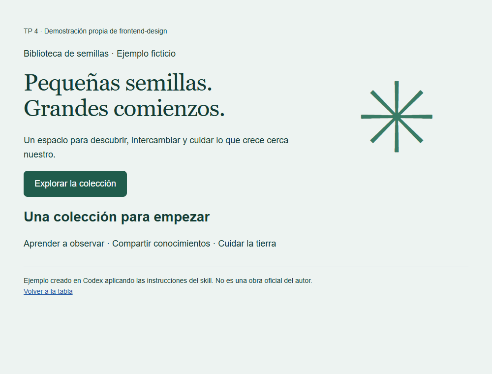
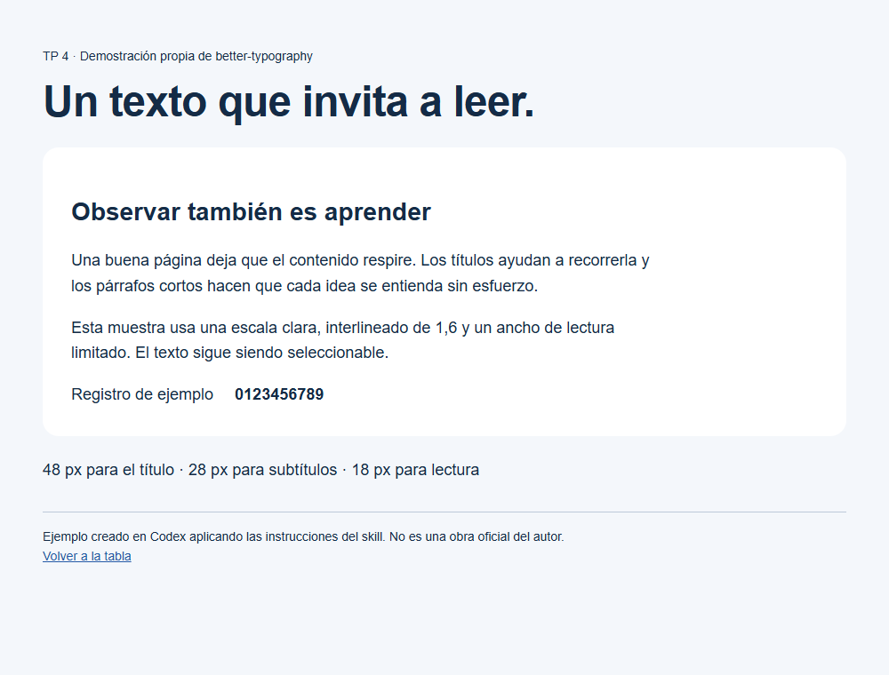
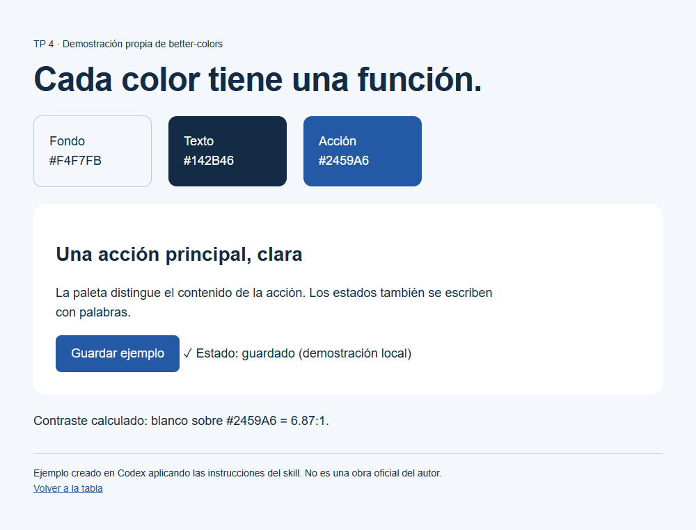
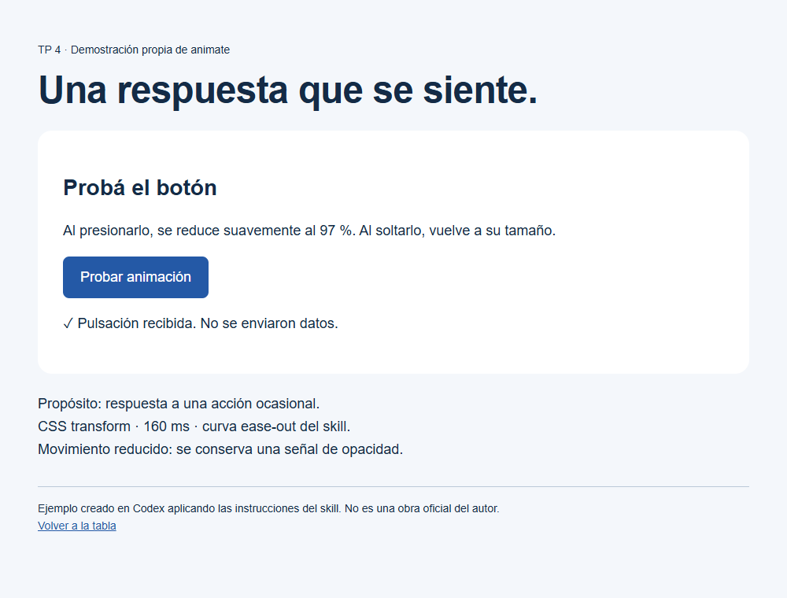
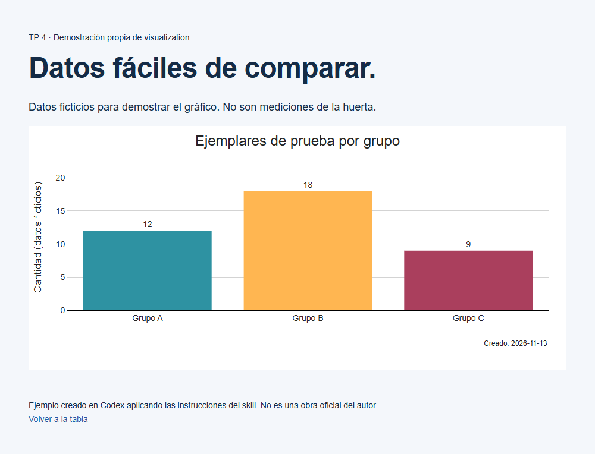

# TP 4 (mini): Tabla de skills para webs lindas

**Integrantes:** Mateo Morea, Nicolás Barrales y Santiago Orlando.  
**Grupo:** Morea, Barrales y Orlando. **Curso:** pendiente de completar.  
**Profesor:** Luis Pandiani. **Fecha de revisión:** 13/11/2026.

Elegimos cinco categorías distintas. Los ejemplos son páginas propias hechas en Codex aplicando las instrucciones de cada skill; no son imágenes oficiales ni pruebas de uso en Claude. El gráfico usa datos ficticios, expresamente identificados.

| Categoría | Nombre | Repo y archivo verificado | Qué hace | Captura de ejemplo |
|---|---|---|---|---|
| Diseño web | **frontend-design** | [anthropics/skills](https://github.com/anthropics/skills) · [SKILL.md](https://github.com/anthropics/skills/blob/41bbe19d1a1a7eaab5e7bb9050a417e5c6cffc8f/skills/frontend-design/SKILL.md) | Define una identidad visual coherente para una página: composición, tipografía y jerarquía. Ayuda a diseñar para el tema del proyecto en lugar de repetir una plantilla genérica. |  |
| Fuentes y tipografía | **better-typography** | [jakubkrehel/skills](https://github.com/jakubkrehel/skills) · [SKILL.md](https://github.com/jakubkrehel/skills/blob/1eb03d2b145df1c6cd84ab54a337600a2a379017/skills/better-typography/SKILL.md) | Ordena tamaños, pesos, interlineado y ancho de los textos para facilitar la lectura. Revisa títulos, saltos de línea y números que cambian. |  |
| Colores y paletas | **better-colors** | [jakubkrehel/skills](https://github.com/jakubkrehel/skills) · [SKILL.md](https://github.com/jakubkrehel/skills/blob/1eb03d2b145df1c6cd84ab54a337600a2a379017/skills/better-colors/SKILL.md) | Organiza la paleta según funciones, como fondo, texto y acción principal. Mide el contraste y evita que un color sea la única señal de un estado. |  |
| Animaciones | **animate** | [emilkowalski/skills](https://github.com/emilkowalski/skills) · [SKILL.md](https://github.com/emilkowalski/skills/blob/f1090bec277140d02ed202440185ad9d02ac1490/skills/animate/SKILL.md) | Decide cuándo una animación ayuda y cómo implementarla con tiempos y curvas concretos. Prioriza movimientos breves y alternativas para quienes prefieren menos movimiento. |  |
| Gráficos | **visualization** | [atlassian-labs/data-visualization-skill](https://github.com/atlassian-labs/data-visualization-skill) · [SKILL.md](https://github.com/atlassian-labs/data-visualization-skill/blob/2846a93e47356ce7415626d867d59a2fa567cbf5/skills/visualization/SKILL.md) | Crea gráficos con Plotly, colores consistentes, etiquetas claras y poco adorno. Ayuda a elegir el tipo de gráfico y permite exportarlo como HTML interactivo. |  |